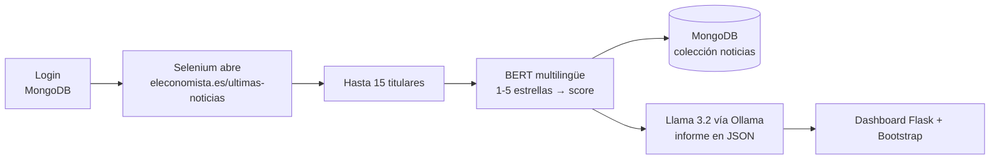

# Analizador de noticias económicas con scraping e IA

Aplicación web en Flask que **extrae en directo los últimos titulares de El Economista**, puntúa el
**sentimiento** de cada uno con un modelo Transformer multilingüe y pide a un **LLM local (Llama 3.2 vía
Ollama)** un informe de mercado en JSON con veredicto, justificación y factores clave. Todo se muestra en
un dashboard con login y las noticias se guardan en MongoDB.

**Stack:** Python · Flask · Selenium · Hugging Face Transformers (BERT multilingüe) · PyTorch ·
Ollama (Llama 3.2) · MongoDB · Bootstrap

## Qué muestra el dashboard

- Hasta **15 titulares** extraídos en directo.
- Las **estrellas** (1-5) que asigna el modelo a cada titular y su score.
- El **score medio** del conjunto, entre −1 (muy negativo) y +1 (muy positivo).
- El **veredicto e interpretación** generados por la IA.
- Los **factores clave** de riesgo u oportunidad.

## Cómo funciona



1. El usuario inicia sesión con credenciales guardadas en MongoDB.
2. Selenium abre la página de últimas noticias, acepta el aviso de cookies si aparece y extrae los titulares.
3. `nlptown/bert-base-multilingual-uncased-sentiment` asigna de 1 a 5 estrellas a cada titular.
4. Las noticias analizadas se guardan en MongoDB y se calcula el score medio.
5. Ollama genera un informe con `format="json"`. Si el modelo devuelve el JSON envuelto en texto o en un
   bloque de código, se extrae y se normalizan las claves antes de mostrarlo.

**Del número de estrellas al score:**

| Estrellas | 1 | 2 | 3 | 4 | 5 |
|---|---|---|---|---|---|
| Score | −1,0 | −0,5 | 0,0 | +0,5 | +1,0 |

## Estructura

```text
analizador-noticias-scraping-ia/
├── app.py                        # Flask: login, flujo de análisis y MongoDB
├── modelos/
│   ├── scraping.py               # Selenium: titulares de El Economista
│   ├── analisis_sentimiento.py   # Transformer de Hugging Face
│   └── generar_informe.py        # informe JSON con Ollama
├── templates/
│   ├── login.html
│   ├── home.html
│   └── index.html                # dashboard (Bootstrap y Font Awesome)
└── requirements.txt
```

## Requisitos

- Python 3.10 o superior.
- Google Chrome (`webdriver-manager` descarga el ChromeDriver compatible).
- [Ollama](https://ollama.com) con el modelo `llama3.2`.
- MongoDB en local o en la nube (por ejemplo, MongoDB Atlas).

## Instalación

```bash
git clone https://github.com/marcforques/analizador-noticias-scraping-ia.git
cd analizador-noticias-scraping-ia
python -m venv .venv
```

Activa el entorno: en Windows `.venv\Scripts\activate`; en Mac/Linux `source .venv/bin/activate`.

```bash
pip install -r requirements.txt
ollama pull llama3.2
```

Si Ollama no está abierto como aplicación, arráncalo con `ollama serve`.

Crea un archivo `.env` en la raíz:

```text
SECRET_KEY=una-clave-secreta
MONGODB_URI=mongodb://localhost:27017/
```

Crea un usuario para poder entrar (la app usa la base de datos `scrapper-ia`):

```bash
mongosh "mongodb://localhost:27017/scrapper-ia" --eval 'db.usuarios.insertOne({login: "demo", password: "demo"})'
```

## Ejecución

```bash
python app.py
```

Abre <http://127.0.0.1:5000/> e inicia sesión. La primera ejecución tarda más porque descarga el modelo
de Hugging Face.

## Limitaciones

- Analiza **titulares**, no el texto completo de las noticias, y como máximo 15.
- Es una señal informativa, **no una recomendación financiera**.
- Si El Economista cambia su HTML, hay que ajustar los selectores XPath de `modelos/scraping.py`.
- La calidad del informe depende del modelo local de Ollama.
- **Seguridad:** las contraseñas se guardan y comparan en texto plano. Es un proyecto de aprendizaje;
  en producción habría que guardarlas con hash (por ejemplo, `werkzeug.security` o bcrypt).

## Posibles mejoras

- Guardar las contraseñas con hash.
- Elegir la fuente de noticias desde la interfaz.
- Guardar el histórico de scores y mostrar su evolución en gráficos.
- Analizar por sectores o palabras clave.
- Hacer el scraping en segundo plano para que la página no se quede esperando.
- Añadir tests del cálculo del score y del parseo de la respuesta de Ollama.

## Autor

Marc Forqués Isasi · [GitHub](https://github.com/marcforques) · [Portfolio](https://marcforquesisasi.vercel.app)
